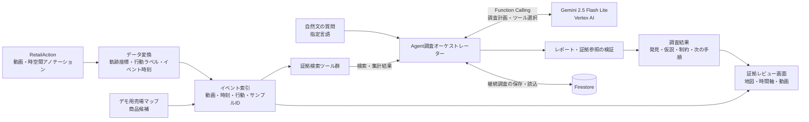

## 課題

店舗では、顧客が商品を手に取ったり棚に戻したりする行動が、映像・商品・売場の情報に分かれて管理されがちです。そのため、気になる変化があっても、該当する場面を探し、商品や売場との関係を確認するには手間がかかります。

## 解決アプローチ

**ShelfTwin** は、行動イベントを時間軸とデジタルマップに結び付け、関連商品や動画証拠を一つの画面から確認できるようにします。

さらに、AIエージェントが自然文の質問に応じて関連する証拠を検索し、根拠付きの調査結果をまとめます。気づきを確認可能な証拠につなぎ、継続調査や現場の判断を支援します。

## アーキテクチャ説明

フロントエンド、API、動画配信はCloud Run上の一つのNode.jsサービスで動作します。AI処理の中心は、質問をツール実行可能な調査へ分解し、得られた構造化データを根拠付きレポートにまとめるAgentです。

### データ処理と時空間インデックス

RetailActionの動画とアノテーションをデモ用形式へ変換し、軌跡を時刻付きのデモ座標に、`take`・`put`・`touch` ラベルを `PICK`・`PUT BACK`・`TOUCH` イベントに正規化します。行動区間はイベント時刻に変換し、動画・サンプル・イベントIDと結び付けます。サーバーは起動後にイベントJSONと売場設定を読み込み、サンプルをまたいで検索できる索引を構築します。イベントから動画ファイルと再生時刻へ戻れるため、集計結果から元の証拠まで追跡できます。

売場や商品との関係はデモ用の対応付けです。商品名は確定SKUではなく候補として扱い、集計も注釈済みイベント数として計算します。

### Agentの調査設計

ユーザーの質問と言語、売場コンテキストをAgentに渡し、Gemini 2.5 Flash LiteをVertex AI経由で呼び出します。Geminiは自由文だけで回答するのではなく、次のサーバー側ツールをFunction Callingで選び、調査を段階的に進めます。

- `query_events`：行動、サンプル、売場、カテゴリで注釈イベントを絞り込みます。
- `aggregate_interactions`：売場単位のイベント数や行動内訳を集計します。
- `get_shelf_context`：売場情報と商品候補を取得します。
- `get_event_evidence`：イベントIDを元動画、再生時刻、売場に解決します。
- `finish_investigation`：発見、仮説、制約、次の手順を指定言語の構造化レポートとして提出します。

各ツール呼び出しはサーバーで引数検証後に実行し、Agentが返す発見には解決済みイベントへの証拠参照を必須にします。これにより、レポートから地図・時間軸・動画へ戻って確認できます。調査は最大5回のモデル要求、12回のツール呼び出し、120秒で打ち切る設計です。元動画はモデルへ送らず、Geminiはイベント注釈、イベント位置・時刻、集計結果、商品候補、売場情報を使って検索とレポート作成を行います。動画の視覚的な内容は、証拠レビュー画面で人が確認します。

### 継続調査と保存

調査ケース、履歴、現場からのフィードバック、担当者の判断、介入後の観察記録はFirestoreにトランザクションで保存します。初回と追加の証拠調査はGeminiが実行し、現場の報告・判断・介入評価は担当者が入力します。日ごとのモデル調査枠もFirestoreで予約し、複数のCloud Runインスタンスや再デプロイをまたいで共有します。介入評価では模擬データと担当者の入力を区別します。

### デモデータの範囲

現在のサンプルは独立して選定された複数の動画で、同一店舗の連続した営業記録ではありません。売場マップと商品情報の一部はデモ用の対応付けです。そのため、正確なSKU特定、購買・売上・転換率、動画をまたいだ同一人物の追跡、PICKとPUT BACKのペア判定は行いません。また、AIは動画を直接視聴せず、注釈と位置情報から調査するため、画面上の行動や原因の確認には人による動画レビューと追加データが必要です。

## データソース

動画サンプルと行動ラベルには、[RetailAction データセット](https://huggingface.co/datasets/standard-cognition/RetailAction)の一部を使用しています。売場マップや商品情報など、デモ用に構成したデータも含まれます。
